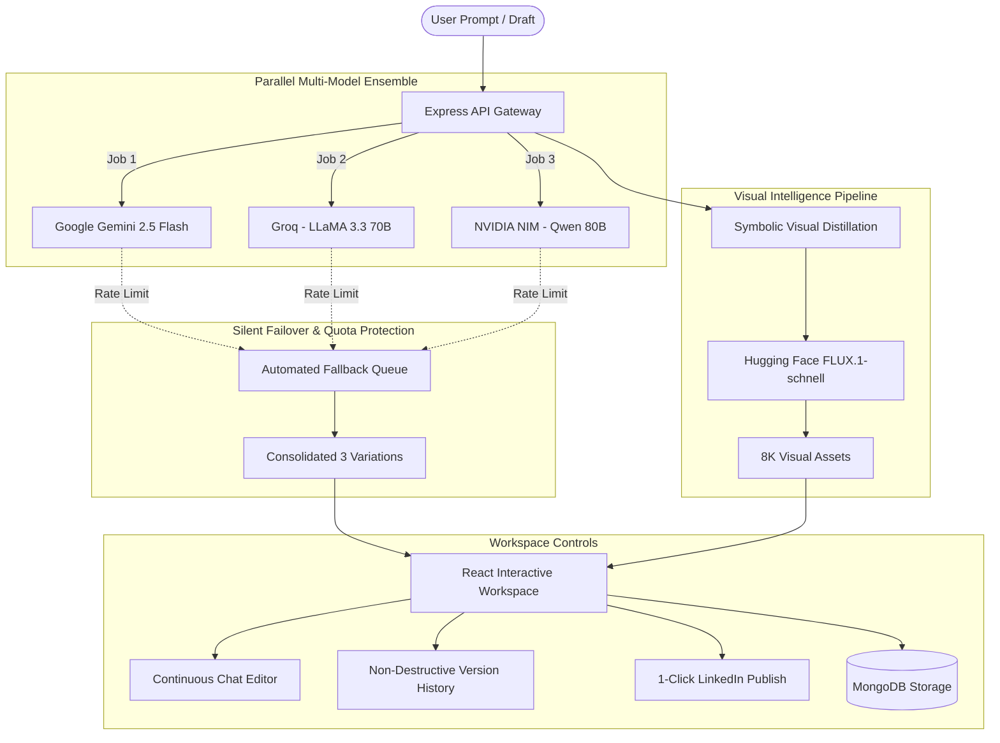

<div align="center">

# 🚀 PostCraft AI

### *AI-Powered LinkedIn Post & Visual Asset Studio*

Turn raw thoughts, rough notes, and business insights into high-converting LinkedIn posts paired with photorealistic 8K visuals in seconds.

[](https://opensource.org/licenses/MIT)
[](https://www.typescriptlang.org/)
[](https://react.dev/)
[](https://tailwindcss.com/)
[](https://expressjs.com/)
[](https://www.mongodb.com/)

[Key Features](#-key-features) • [Architecture](#-architecture--silent-failover) • [Tech Stack](#-tech-stack) • [Quick Start](#-quick-start) • [Environment Variables](#-environment-variables) • [API Reference](#-api-reference)

---

</div>

## 📖 Overview

**PostCraft AI** is an end-to-end LinkedIn content generation and refinement engine. Unlike standard single-prompt wrappers, PostCraft AI uses a **cascading multi-LLM ensemble architecture** (Google Gemini 2.5 Flash, Groq / Meta LLaMA 3.3 70B, and NVIDIA NIM / Qwen) to generate 3 diverse, high-engagement post variations concurrently.

Each post is automatically paired with studio-grade imagery generated by **Black Forest Labs FLUX.1-schnell** via Hugging Face. The built-in workspace enables conversational chat refinement, full non-destructive version history, draft polishing, and 1-click sharing to LinkedIn.

---

## ✨ Key Features

### ⚡ Multi-Model AI Ensemble
* **Parallel Multi-LLM Generation**: Generates 3 distinct post variations at once across three premier AI providers:
  * 🧠 **Google Gemini 2.5 Flash**
  * ⚡ **Groq Cloud (LLaMA 3.3 70B Versatile)**
  * 🟢 **NVIDIA NIM (Qwen 3 / Qwen 2.5 80B)**
* **Zero-Downtime Silent Failover**: Built-in retry and fallback queue guarantees you always receive 3 complete variations, even when individual model quotas or rate limits are reached.

### 🎨 Photorealistic Visual Asset Generation
* **FLUX.1-schnell Integration**: Generates ultra-crisp, 8K cinematic imagery for every post using state-of-the-art diffusion models.
* **Intelligent Subject Distillation**: Automatically removes social media UI buzzwords and extracts clean, symbolic physical metaphors (e.g. workspace setups, architectural scenes, natural metaphors) to ensure watermark-free visuals.
* **Iterative Visual Refinement**: Cycle between visual concepts, regenerate styles, inspect in a full-screen lightbox modal, and download uncompressed high-resolution PNGs.

### 💬 In-Line Conversational Post Editing & Version Control
* **Targeted AI Chat Refinement**: Click **Edit** on any post variation and converse directly with the AI (e.g., *"Make the hook punchier"*, *"Add 3 trending hashtags"*, *"Shorten the body"*).
* **Provider-Aware Routing**: Directs your edit requests back to the specific LLM that authored that variation for stylistic consistency.
* **Full Undo/Redo Version History**: Easily step back and forth between versions (`Version 1 / 4`) without losing any generated copy.
* **Fresh Angle Redo**: 1-click regenerate with fresh perspectives while preserving the core premise.

### 📝 Draft Improver Mode
* Transform existing rough notes, bullet points, or unpolished drafts into 3 publication-ready LinkedIn posts with optimized readability, spacing, and engagement hooks.

### 🚀 Seamless LinkedIn Publishing
* **1-Click Share**: Automatically copies the finalized post to your clipboard and launches LinkedIn's web composer pre-populated with your post content.

### 🔐 User Authentication & Persistent History
* Full account registration and login powered by **JWT** (JSON Web Tokens) and **bcrypt** password hashing.
* MongoDB database stores all user prompts, post variations, and generated visual assets for on-demand review and retrieval.

---

## 🏛 Architecture & Silent Failover



---

## 🛠 Tech Stack

| Category | Technologies & Frameworks |
| :--- | :--- |
| **Frontend** | React 18, TypeScript, Vite, Tailwind CSS, Radix UI Primitives, Framer Motion, Lucide Icons, Wouter |
| **State & Data Fetching** | TanStack React Query v5 |
| **Backend** | Node.js, Express.js 5, TypeScript (`tsx` runtime), Zod |
| **AI LLM Models** | Google Gemini (`@google/genai`), Groq Cloud API, NVIDIA NIM API |
| **Image Generation** | Hugging Face Inference API (`black-forest-labs/FLUX.1-schnell`) |
| **Database & Auth** | MongoDB (Mongoose ODM), JWT (`jsonwebtoken`), bcryptjs |
| **Styling & Animation** | Tailwind CSS, `tailwindcss-animate`, Framer Motion |

---

## 📂 Project Structure

```
Asset-Linker/
├── client/                     # Frontend React application
│   ├── src/
│   │   ├── components/         # UI components (Tabs, CopyButton, HistoryView, Radix UI)
│   │   │   └── ui/             # Radix UI design system primitives
│   │   ├── hooks/              # Custom React hooks (use-auth, use-posts, use-history)
│   │   ├── lib/                # React Query client and utility functions
│   │   ├── pages/              # Main views (Home, AuthPage, NotFound)
│   │   ├── App.tsx             # Root router and auth gate
│   │   ├── index.css           # Global Tailwind styling & animations
│   │   └── main.tsx            # React DOM bootstrap
│   └── index.html              # HTML entry point
│
├── server/                     # Backend Express server (TypeScript)
│   ├── auth.ts                 # User authentication, JWT issuance & verification
│   ├── db.ts                   # Database connection handlers
│   ├── history.ts              # Post history persistence endpoints
│   ├── infip.ts                # Hugging Face FLUX.1 image generator
│   ├── models.ts               # Mongoose schemas (User, History)
│   ├── routes.ts               # Multi-LLM routing, failover engine, and edit API
│   ├── static.ts               # Production static file serving
│   └── index.ts                # Express application bootstrap & MongoDB connection
│
├── shared/                     # Shared TypeScript contracts
│   ├── models/                 # Shared data models
│   ├── routes.ts               # Type-safe API route definitions
│   └── schema.ts               # Shared database schemas and Zod validators
│
├── .env.example                # Template for environment configuration
├── package.json                # Dependencies, scripts, and project metadata
├── tailwind.config.ts          # Tailwind CSS design system configuration
├── tsconfig.json               # TypeScript compiler configuration
└── vite.config.ts              # Vite bundler configuration
```

---

## 🚀 Quick Start

### Prerequisites
Make sure you have the following installed on your machine:
* **[Node.js](https://nodejs.org/)** (v18.0.0 or higher)
* **[npm](https://www.npmjs.com/)** or **[pnpm](https://pnpm.io/)**
* **[MongoDB](https://www.mongodb.com/try/download/community)** running locally on port `27017` (or a MongoDB Atlas URI)

### 1. Clone the Repository
```bash
git clone https://github.com/aasama02-05/PostCraftAi.git
cd PostCraftAi
```

### 2. Install Dependencies
```bash
npm install
```

### 3. Configure Environment Variables
Copy the `.env.example` file to `.env`:
```bash
cp .env.example .env
```
Fill in your API keys in `.env` (refer to [Environment Variables](#-environment-variables) below).

### 4. Start MongoDB
Ensure your MongoDB daemon is running locally:
```bash
# Windows (if registered as a service)
net start MongoDB

# Linux / macOS
mongod --dbpath /data/db
```

### 5. Run the Application
Start the development server (runs both backend API and frontend Vite dev server concurrently):
```bash
npm run dev
```

Open your browser and navigate to:
```
http://localhost:5000
```

---

## 🔑 Environment Variables

Create a `.env` file in the root directory with the following variables:

```env
# Server Configuration
PORT=5000
NODE_ENV=development

# JWT Authentication
JWT_SECRET=your_super_secret_jwt_key

# Database
MONGODB_URI=mongodb://localhost:27017/PostCraft-AI

# AI Provider 1: Google Gemini (Gemini 2.5 Flash)
AI_INTEGRATIONS_GEMINI_API_KEY=your_gemini_api_key
GEMINI_API_KEY=your_gemini_api_key

# AI Provider 2: Groq Cloud (LLaMA 3.3 70B)
GROQ_API_KEY=your_groq_api_key

# AI Provider 3: NVIDIA NIM (Qwen 3 / Qwen 2.5)
NVIDIA_API_KEY=your_nvidia_api_key

# Image Generation: Hugging Face (FLUX.1-schnell)
HUGGINGFACE_API_KEY=your_huggingface_token
```

> **Where to get API keys:**
> * **Google Gemini**: [Google AI Studio](https://aistudio.google.com/)
> * **Groq**: [Groq Cloud Console](https://console.groq.com/)
> * **NVIDIA NIM**: [NVIDIA build platform](https://build.nvidia.com/)
> * **Hugging Face**: [Hugging Face Settings > Access Tokens](https://huggingface.co/settings/tokens)

---

## 📡 API Reference

### 🔐 Authentication

| Endpoint | Method | Body | Description |
| :--- | :--- | :--- | :--- |
| `/api/auth/signup` | `POST` | `{ name, email, password }` | Register a new user account & return JWT |
| `/api/auth/login` | `POST` | `{ email, password }` | Authenticate existing user & return JWT |

### ✍️ Content Generation & Editing

| Endpoint | Method | Body | Description |
| :--- | :--- | :--- | :--- |
| `/api/posts/generate` | `POST` | `{ topic, tone }` | Generate 3 variations across Gemini, Groq, and NVIDIA with FLUX image |
| `/api/posts/refine` | `POST` | `{ draft }` | Refine and polish a raw draft into 3 professional variations |
| `/api/posts/edit` | `POST` | `{ originalContent, instructions, provider }` | Apply conversational edits to a specific post variation |
| `/api/posts/images` | `POST` | `{ topic, isImprovement? }` | Generate or iteratively enhance FLUX visual assets |

### 📜 Post History

| Endpoint | Method | Headers | Description |
| :--- | :--- | :--- | :--- |
| `/api/history` | `GET` | `Authorization: Bearer <token>` | Retrieve authenticated user's generation history |
| `/api/history/save` | `POST` | `Authorization: Bearer <token>` | Save newly generated posts and visual assets to history |

---

## 🎯 Available Tones

PostCraft AI supports fine-tuned prompting tailored to specific professional communication styles:
* 💼 **Professional**: Clean, authoritative, and industry-oriented.
* 📖 **Storytelling**: Narrative hook, tension, resolution, and personal takeaways.
* 🎓 **Educational**: Step-by-step breakdown, bulleted insights, and actionable frameworks.
* 💡 **Informative**: Data-driven, concise, and focused on industry updates.
* 🔥 **Motivational**: Inspirational, uplifting, and momentum-building.
* 🌟 **Thought Leadership**: Visionary perspective challenging conventional wisdom.

---

## 🤝 Contributing

Contributions are welcome! Whether it is fixing bugs, adding new LLM providers, or polishing UI animations:

1. **Fork** the repository.
2. **Create** your feature branch:
   ```bash
   git checkout -b feature/amazing-feature
   ```
3. **Commit** your changes:
   ```bash
   git commit -m "Add amazing new feature"
   ```
4. **Push** to the branch:
   ```bash
   git push origin feature/amazing-feature
   ```
5. **Open** a Pull Request.

---

## 📄 License

This project is licensed under the [MIT License](LICENSE).

---

<div align="center">

Made with ❤️ by [aasama02-05](https://github.com/aasama02-05)

*Elevate your professional LinkedIn presence with AI.*

</div>

